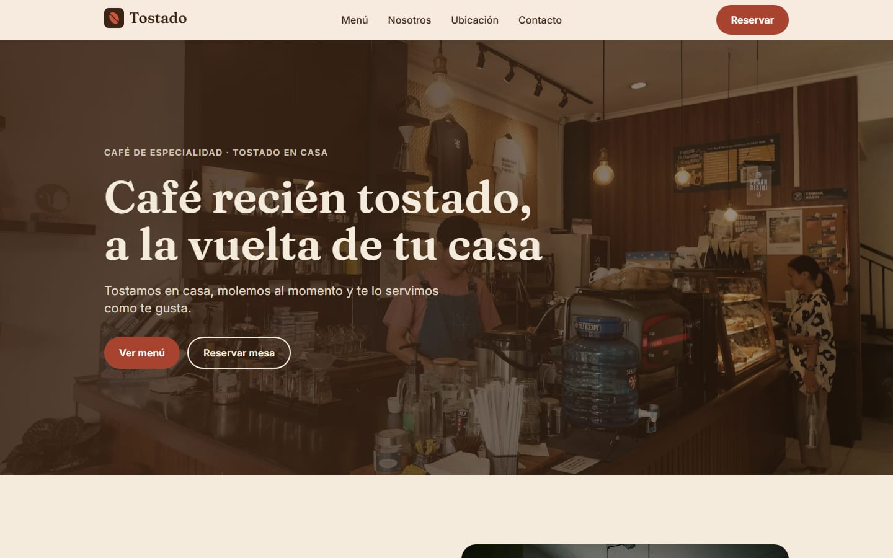
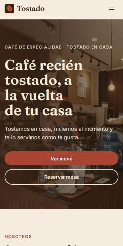

# Tostado · Café de barrio

Landing page de una sola página para **Tostado**, una cafetería de especialidad ficticia. Es un proyecto de portafolio: el negocio, los datos de contacto y las reseñas son inventados.

**🔗 Sitio en vivo:** https://glistening-squirrel-ed591c.netlify.app

<p>
  
  
</p>

## Qué incluye

- **9 secciones:** header con menú móvil, hero, nosotros, menú, galería, testimonios, ubicación con mapa, formulario de reservas y footer.
- **Formulario de reservas** con [Netlify Forms](https://docs.netlify.com/forms/setup/): validación nativa del navegador, campo anti-spam (honeypot) y página de confirmación `/gracias`.
- **Botón de WhatsApp** con el mensaje ya escrito.
- **Responsive, mobile-first:** probado en 375, 768, 1024 y 1440 px.
- **Accesible:** HTML semántico, un solo `h1`, `alt` en todas las imágenes, contraste AA, foco visible y navegación completa con teclado.
- **SEO:** título y descripción, Open Graph, sitemap, `robots.txt` y datos estructurados `CafeOrCoffeeShop` en JSON-LD.
- **Rápido:** imágenes WebP en varios tamaños con `<Image />` de Astro, fuentes servidas desde el propio sitio y **un solo script** (el menú móvil). Las animaciones al hacer scroll son solo CSS y respetan `prefers-reduced-motion`.

### Lighthouse (móvil)

| Rendimiento | Accesibilidad | Buenas prácticas | SEO |
| :---------: | :-----------: | :--------------: | :-: |
|     98      |      100      |       100        | 100 |

## Stack

| Pieza      | Elección                                                           |
| ---------- | ------------------------------------------------------------------ |
| Framework  | [Astro 7](https://astro.build) + TypeScript estricto               |
| Estilos    | [Tailwind CSS v4](https://tailwindcss.com) vía `@tailwindcss/vite` |
| Fuentes    | Fraunces y Inter, con la API de fuentes de Astro                   |
| Mapa       | OpenStreetMap (sin claves ni cookies de rastreo)                   |
| Formulario | Netlify Forms                                                      |
| Formato    | Prettier con los plugins de Astro y Tailwind                       |
| Despliegue | Netlify                                                            |

## Cómo correrlo

Requiere **Node 22.23 o superior**.

```bash
npm install
npm run dev
```

Abre http://localhost:4321.

| Comando           | Qué hace                                      |
| ----------------- | --------------------------------------------- |
| `npm run dev`     | Servidor local con recarga automática         |
| `npm run build`   | Compila el sitio a `dist/`                    |
| `npm run preview` | Sirve el build para probarlo antes de subirlo |
| `npm run check`   | Revisa los tipos de TypeScript                |
| `npm run format`  | Formatea todo el código con Prettier          |

> El formulario solo envía en Netlify. En local, enviarlo da error y es normal.

## Estructura

```
src/
├── assets/images/   fotos (Astro las optimiza a WebP)
├── components/      una sección por componente + ui/ (Button, SectionHeading)
├── data/            todos los textos, precios, horarios y datos de contacto
├── layouts/         BaseLayout: <head>, SEO y JSON-LD
├── lib/             utilidades (formato de precios, imágenes, enlaces)
├── pages/           index.astro (solo ensambla secciones) y gracias.astro
└── styles/          global.css: tema con @theme, estilos base y animaciones
```

### Reutilizarlo para otro negocio

Ningún texto está escrito dentro de los componentes. Para convertir la página en, por ejemplo, un gimnasio:

1. Cambia los textos y datos en `src/data/` (`site.ts`, `menu.ts`, `testimonials.ts`).
2. Cambia los colores en el bloque `@theme` de `src/styles/global.css` y las fuentes en `astro.config.mjs`.
3. Reemplaza las fotos en `src/assets/images/` manteniendo los nombres (`hero.jpg`, `nosotros.jpg`, `galeria-1.jpg` … `galeria-6.jpg`).

## Créditos

Fotos de [Unsplash](https://unsplash.com), bajo la licencia de Unsplash:
[Syauqy Ayyash](https://unsplash.com/photos/barista-preparing-drinks-behind-a-coffee-shop-counter-BBZ1O-D3gYc),
[Nikita Pishchugin](https://unsplash.com/photos/cafe-interior-with-tables-and-chairs-near-window-B5giYHNQPvA),
[Blake Wisz](https://unsplash.com/photos/barista-preparing-coffee-with-espresso-machine-in-cafe-vCtvn_xqoyA),
[Indra Projects](https://unsplash.com/photos/roasted-coffee-beans-are-displayed-up-close-H80RH1Hhvu8),
[Di Bella Coffee](https://unsplash.com/photos/white-ceramic-coffee-cup-with-latte-art-s1-VmA26BIc),
[Siyi](https://unsplash.com/photos/a-glass-display-case-filled-with-croissants-on-top-of-a-counter-w-8SzMGe3H0),
[Melody Zimmerman](https://unsplash.com/photos/a-wooden-table-topped-with-two-cups-of-coffee-gjW47r1K63Y) e
[Ilham Danu Kusuma](https://unsplash.com/photos/a-coffee-maker-pouring-coffee-into-a-cup-f0CWl1svJHM).
